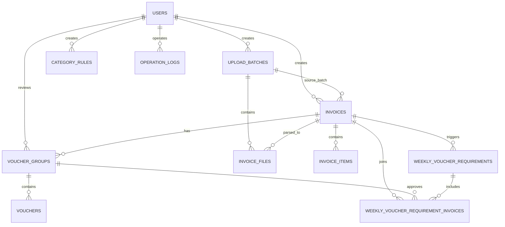

# 数据库设计说明

本文档对应 [`sql/schema.sql`](../sql/schema.sql)，以该文件为当前数据库结构的唯一准则。系统使用 MySQL 8.0+、InnoDB、`utf8mb4` 和原生参数化 SQL。

最新 `schema.sql` 用于初始化全新的空数据库，已包含当前最终表结构和 149 条默认品类规则。已有业务数据的旧数据库应根据实际缺失结构选择迁移文件升级，不能重复执行完整初始化脚本。

## 表关系

上传文件先归属 `upload_batches`。PDF 识别成功后，`invoice_files.invoice_id` 才关联到 `invoices`；因此该字段允许为空。

## 主要表

### `users`

保存用户账号、密码哈希、角色和启用状态。当前接口仅允许 `admin` 角色操作，其他角色枚举用于后续扩展。

| 字段 | 类型 | 说明 |
|---|---|---|
| `id` | BIGINT UNSIGNED | 主键，自增 |
| `username` | VARCHAR(64) | 登录用户名，唯一 |
| `password_hash` | VARCHAR(255) | bcrypt 密码哈希 |
| `role` | ENUM | `admin`、`user`、`finance`、`reviewer` |
| `is_active` | BOOLEAN | 是否允许登录 |
| `last_login_at` | DATETIME | 最近登录时间 |
| `created_at` / `updated_at` | DATETIME | 创建和更新时间 |

### `upload_batches`

记录一次上传任务及其总体处理进度。

| 字段 | 类型 | 说明 |
|---|---|---|
| `id` | CHAR(36) | 上传批次 UUID |
| `original_name` | VARCHAR(255) | 原始上传名称 |
| `file_type` | ENUM | `pdf`、`multiple_pdf`、`zip`、`mixed` |
| `status` | ENUM | `pending`、`processing`、`completed`、`partial_failed`、`failed` |
| `total_count` / `success_count` / `failed_count` | INT UNSIGNED | 批次处理统计 |
| `error_message` | TEXT | 批次级错误说明 |
| `created_by` | BIGINT UNSIGNED | 创建用户，可为空 |
| `created_at` / `updated_at` | DATETIME | 创建和更新时间 |

### `invoices`

保存发票主数据、审核结论、自然周累计快照和财务/报销状态。

| 字段 | 类型 | 说明 |
|---|---|---|
| `invoice_number` | VARCHAR(64) | 发票号码或数电票号码，可为空以支持人工补全 |
| `invoice_date` | DATE | 开票日期，不作为自然周累计依据 |
| `seller_name` / `seller_tax_id` | VARCHAR | 销售方名称和纳税人识别号 |
| `total_amount` | DECIMAL(12,2) | 价税合计，受非负约束 |
| `submitted_at` | DATETIME | 提交审核时间，自然周累计的时间依据 |
| `qualification_status` | ENUM | `pending`、`pending_voucher`、`pending_manual`、`approved`、`rejected`、`cancelled` |
| `finance_status` | ENUM | `not_submitted`、`submitted` |
| `reimbursement_status` | ENUM | `not_completed`、`success`、`failed` |
| `qualification_reason` | TEXT | 审核结论和原因 |
| `cumulative_amount` / `cumulative_week_start` | DECIMAL / DATE | 本次规则审核的自然周累计快照 |
| `source_batch_id` | CHAR(36) | 来源上传批次 |
| `ai_raw_result` | JSON | AI 结构化调用的原始结果 |
| `manual_note` | TEXT | 人工处理说明 |
| `created_by` | BIGINT UNSIGNED | 创建用户，可为空 |

### `invoice_files`

保存发票原始文件及提取状态。

| 字段 | 类型 | 说明 |
|---|---|---|
| `batch_id` | CHAR(36) | 所属上传批次，可为空，外键关联 `upload_batches` |
| `invoice_id` | BIGINT UNSIGNED | 识别成功后关联的发票，可为空，外键关联 `invoices` |
| `original_name` | VARCHAR(255) | 用户上传时的原始文件名 |
| `storage_key` | VARCHAR(512) | 本地或对象存储的相对标识，不向前端暴露绝对路径 |
| `mime_type` / `file_size` | VARCHAR / BIGINT | 文件类型与字节数 |
| `sha256` | CHAR(64) | 文件内容哈希，用于查询和追溯；当前为普通索引，不是唯一约束 |
| `extraction_status` | ENUM | `pending`、`success`、`failed` |
| `extraction_error` | TEXT | 提取失败原因 |

### `invoice_items`

保存商品明细、价格分类和 AI/人工品类判断。

| 字段 | 类型 | 说明 |
|---|---|---|
| `invoice_id` | BIGINT UNSIGNED | 所属发票，必填 |
| `item_name` | VARCHAR(255) | 商品名称 |
| `quantity` | DECIMAL(12,4) | 商品数量，可为空 |
| `unit_price` | DECIMAL(24,13) | 含税单价，保留发票原始精度 |
| `price_type` | ENUM | `material`、`low_value`、`asset` |
| `line_amount` | DECIMAL(12,2) | 商品行金额 |
| `ai_category_result` | ENUM | AI 或长期规则的原始品类结果：可以、存疑、不可以 |
| `ai_category_reason` | TEXT | AI 或长期规则判断依据 |
| `manual_category_result` | ENUM | 管理员人工品类判断 |
| `manual_category_reason` | TEXT | 人工判断依据 |
| `final_category_result` | ENUM | 当前生效的最终品类结果 |

`unit_price` 与 `line_amount` 均有非负 `CHECK` 约束。旧字段 `category_reason` 已不存在。

### `category_rules`

保存管理员维护的长期关键词规则。`priority` 数值越小优先级越高；启用规则优先于 AI 品类辅助判断。

| 字段 | 类型 | 说明 |
|---|---|---|
| `rule_name` | VARCHAR(128) | 规则名称 |
| `keyword` | VARCHAR(128) | 商品名称匹配关键词 |
| `category_result` | ENUM | 可以、存疑、不可以 |
| `priority` | INT | 匹配优先级，默认 100 |
| `is_active` | BOOLEAN | 是否启用 |
| `created_by` | BIGINT UNSIGNED | 创建用户，可为空 |

### `voucher_groups` 与 `vouchers`

一张发票可以拥有多个凭证组；每个凭证组属于一张发票。

`voucher_groups.review_status` 的取值为：

- `pending_upload`：待上传文件；
- `pending_review`：文件已上传，待人工审核；
- `approved`：审核通过；
- `rejected`：审核不通过。

`vouchers.voucher_type` 的取值为 `order_screenshot` 或 `payment_record`。完整凭证组必须同时具备两种类型的文件，由服务层和人工审核保证。当前数据库仅建立 `(voucher_group_id, voucher_type)` 普通索引，允许同一凭证组上传多份同类型文件。

### `weekly_voucher_requirements`

当同一销售方同一自然周累计金额大于 1000 元且不超过 3000 元时，保存跨发票凭证补齐任务。

| 字段 | 说明 |
|---|---|
| `seller_tax_id` / `cumulative_week_start` | 任务所属销售方和自然周 |
| `trigger_invoice_id` | 触发任务的当前发票 |
| `triggered_cumulative_amount` | 触发时累计金额，受 `>1000` 且 `<=3000` 约束 |
| `status` | `pending`、`completed`、`cancelled` |
| `active_task_key` | 仅 `pending` 任务生成的存储生成列，用于限制同销售方同周只能有一个进行中任务 |

### `weekly_voucher_requirement_invoices`

记录周累计凭证任务关联的每张发票、凭证完成状态及通过的凭证组。`(requirement_id, invoice_id)` 为唯一键，防止同一发票重复加入同一任务。

### `operation_logs`

记录人工修改、审核和状态变更的审计日志。

| 字段 | 说明 |
|---|---|
| `operator_id` | 操作用户，可为空 |
| `operation_type` | 操作类型 |
| `resource_type` / `resource_id` | 被操作资源 |
| `before_data` / `after_data` | JSON 格式的变更前后快照 |
| `ip_address` / `user_agent` | 操作来源信息 |
| `created_at` | 日志创建时间；该表没有 `updated_at` |

## 关键约束和索引

- `users.username` 唯一。
- `invoice_files.batch_id`、`invoice_files.invoice_id`、`invoices.source_batch_id` 均使用外键保证关联完整性。
- `invoices.total_amount`、`invoice_items.unit_price`、`invoice_items.line_amount` 不能为负。
- `weekly_voucher_requirements` 用 `active_task_key` 唯一键限制每个销售方、每个自然周只能存在一个待完成任务。
- 自然周累计查询使用 `idx_invoices_seller_submitted_qualification`；财务分组与提交基于销售方税号、提交审核时间和资质审核状态。
- 外键删除策略以当前 `schema.sql` 为准：删除上传批次会级联删除关联文件，删除发票会级联删除商品明细和凭证组。

## 规则落库原则

- 商品单价 `<500`、`500–<1000`、`>=1000` 的判断由服务层执行，表中保存单价和分类结果。
- 自然周累计使用销售方税号、提交审核时间和价税合计；只纳入符合规则的有效发票。
- AI 原始结果、人工结果和最终结果分开保存，人工修改不覆盖 AI 原始证据。
- 状态变更、累计计算和凭证审核等关键操作由事务保护，并通过 `operation_logs` 留痕。
